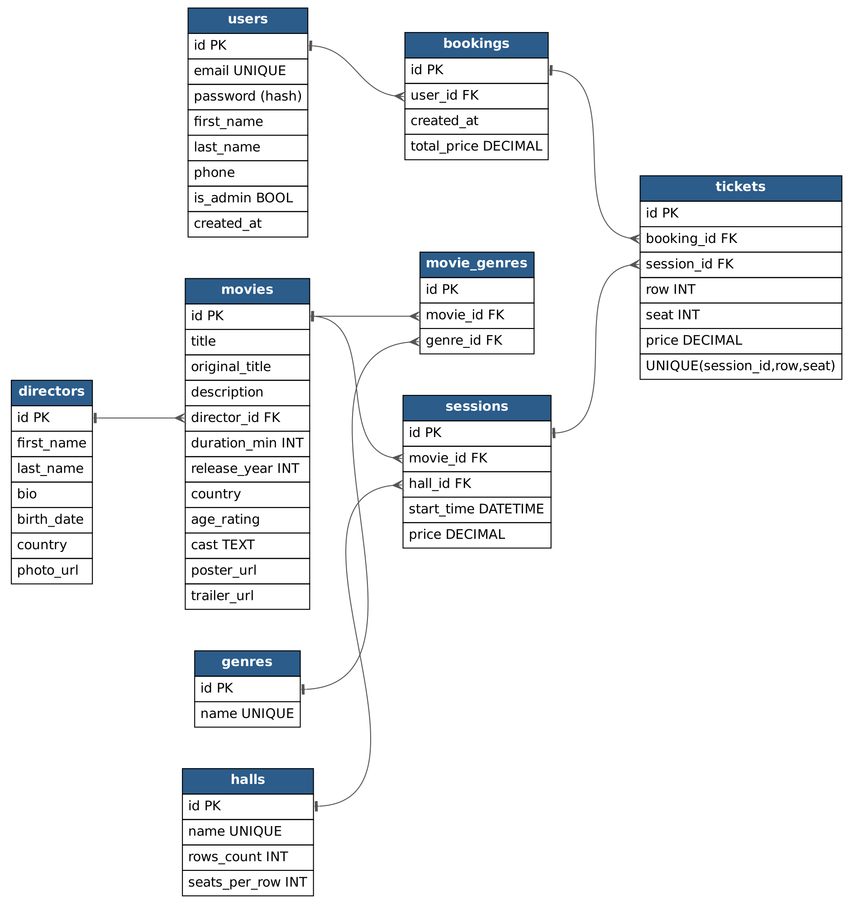

# Кінотеатр «Кадр»

Вебсайт кінотеатру, де можна переглянути афішу, обрати сеанс і забронювати квитки онлайн.

## Опис

**«Кадр»** — сайт міського кінотеатру з кількома залами. Відвідувач може дізнатися, які фільми зараз у прокаті, коли вони показуються, і забронювати квитки на конкретні місця, не стоячи в черзі в касі.

### Що є на сайті

- **Афіша** — список усіх фільмів. Фільми можна шукати за назвою або режисером, фільтрувати за жанром, віковим обмеженням і датою показу. Список можна сортувати за назвою, роком виходу, тривалістю та популярністю (скільки квитків продано).
- **Сторінка фільму** — опис, постер, трейлер, режисер, жанри, тривалість, вікове обмеження, актори та розклад сеансів цього фільму.
- **Режисери** — список режисерів. На сторінці режисера є коротка біографія та всі його фільми, які є в кінотеатрі.
- **Жанри** — перелік жанрів. Якщо обрати жанр, показуються всі фільми цього жанру.
- **Розклад сеансів** — усі сеанси на обрану дату: фільм, зал, час початку і ціна квитка.
- **Вибір місць** — схема залу для обраного сеансу, на якій видно вільні та зайняті місця.
- **Бронювання** — зареєстрований користувач обирає одне або кілька вільних місць і натискає «Забронювати». Бронювання створюється відразу, без оплати (спрощення).
- **Реєстрація та вхід.**
- **Профіль** — особисті дані, які можна редагувати, та історія бронювань із квитками.
- **Адміністрування** — адміністратор може додавати, редагувати й видаляти фільми, режисерів, жанри, зали та сеанси.
- **«Про нас»** — адреса, контакти, як доїхати та правила повернення квитків. Це статична сторінка: вона зберігається на фронтенді й окремого ендпоінту не потребує.

## Схема бази даних



Файл для редагування: [`docs/db_schema.drawio`](docs/db_schema.drawio).

Основні зв'язки:

- у фільму один режисер, а в режисера багато фільмів;
- фільм і жанр пов'язані як «багато до багатьох» через таблицю `movie_genres`;
- сеанс — це показ одного фільму в одному залі в певний час;
- бронювання належить одному користувачу й містить один або кілька квитків;
- квиток — це конкретне місце (ряд + номер) на конкретному сеансі. Обмеження `UNIQUE(session_id, row, seat)` не дає продати одне місце двічі.

## Стан реалізації

Реалізовано:

- реєстрація з валідацією полів; пароль зберігається лише в захешованому вигляді;
- вхід через JWT (access і refresh токени) та оновлення access токена;
- ендпоінт `GET /api/v1/users/me` з даними поточного користувача;
- права доступу: переглядати дані можуть усі, а додавати, змінювати й видаляти — лише адміністратор;

- створення, перегляд (список і окремий об'єкт), редагування та видалення фільмів, режисерів, жанрів, залів і сеансів;
- пошук, фільтри, сортування й пагінація для списків;
- бізнес-правила: не можна видалити режисера, за яким закріплені фільми, жанр, до якого прив'язані фільми, фільм або зал, для яких створено сеанси; сеанси в одному залі не можуть перетинатися; сеанс не можна створити в минулому;
- однаковий формат помилок для всіх ендпоінтів (`400`, `404`, `409`);
- CORS для фронтенду на `http://localhost:3000`.

Ще не реалізовано (наступні етапи): редагування профілю, бронювання та схема зайнятих місць. У документації нижче такі розділи позначено «ще не реалізовано».

## Як запустити проєкт

Потрібен Python 3.12 або новіший. Команди виконуються з папки, де лежить `manage.py`.

1. Створіть і активуйте віртуальне середовище:

   ```bash
   python -m venv .venv
   source .venv/bin/activate
   ```

   На Windows: `.venv\Scripts\activate`.

2. Встановіть залежності:

   ```bash
   python -m pip install -r requirements-dev.txt
   ```

3. Застосуйте міграції, щоб створити базу даних SQLite:

   ```bash
   python manage.py migrate
   ```

4. Запустіть сервер:

   ```bash
   python manage.py runserver
   ```

API буде доступне за адресою `http://127.0.0.1:8000/api/v1/`, адмінка — `http://127.0.0.1:8000/admin/`.

Щоб додавати й змінювати дані через API, потрібен адміністратор. Створіть його командою:

```bash
python manage.py createsuperuser
```

Користувачі, зареєстровані через `POST /api/v1/auth/register`, адміністраторами не є. Зробити користувача адміністратором можна в адмінці (позначка «Staff status»).

Фронтенд лежить в окремому репозиторії й запускається на `http://localhost:3000`. Бекенд дозволяє запити з цієї адреси (налаштування `CORS_ALLOWED_ORIGINS` у `config/settings.py`).

### Тести та перевірка коду

```bash
python manage.py test
python check_submission.py
```

### Postman

Колекція запитів лежить у `postman/cinema-kadr.postman_collection.json` (формат Collection v2.1). Імпортуйте її в Postman (Import → File). Адреса сервера задана змінною колекції `base_url` (за замовчуванням `http://127.0.0.1:8000`). Запити створення зберігають `id` у змінні колекції, тому папки варто запускати по черзі: Auth → Genres → Directors → Movies → Halls → Sessions → Business rules (409) → Cleanup (delete).

Перед запуском створіть адміністратора (`python manage.py createsuperuser`) і впишіть його логін і пароль у змінні колекції `admin_username` і `admin_password` (за замовчуванням `admin` / `AdminPass123`). Запит «Login as admin» у папці Auth зберігає токен адміністратора в змінну `admin_token`, і всі інші запити колекції відправляються з ним. Запити, які перевіряють 401 і 403, відправляються без токена або з токеном звичайного користувача.

## REST API

### Загальні правила

- Базовий URL: `/api/v1`
- Дані передаються у форматі **JSON** (`Content-Type: application/json`).
- Назви ресурсів — іменники в множині (`/movies`, `/sessions`). Дію визначає HTTP-метод.
- Для оновлення використовується **`PATCH`**: передаються тільки ті поля, які треба змінити.
- Списки повертаються з пагінацією: параметри `page` (за замовчуванням 1) і `page_size` (за замовчуванням 20, максимум 100). У `next` і `previous` повертаються повні посилання на сусідні сторінки.
- Дата й час передаються у форматі ISO 8601 (`2026-10-20T19:30:00+03:00`). Відповіді повертають час у часовому поясі Києва.
- Символ `+` у query-параметрах треба кодувати як `%2B` (наприклад, `age_rating=12%2B`), інакше він перетвориться на пробіл.

Формат відповіді зі списком:

```json
{
  "count": 125,
  "next": "http://127.0.0.1:8000/api/v1/movies?page=3",
  "previous": "http://127.0.0.1:8000/api/v1/movies?page=1",
    "results": [
    {
      "id": 12,
      "title": "Дюна: Частина друга",
      "poster_url": "https://example.com/posters/dune2.jpg",
      "release_year": 2024,
      "duration_min": 166,
      "age_rating": "12+",
      "genres": [{ "id": 3, "name": "Фантастика" }],
      "director": { "id": 5, "first_name": "Дені", "last_name": "Вільнев" }
    }
  ]
}
```

Формат відповіді з помилкою:

```json
{
  "error": "Опис помилки",
  "details": { "field_name": ["Повідомлення про помилку поля"] }
}
```

### Статус-коди

| Код | Значення |
|-----|----------|
| `200 OK` | Успішний запит |
| `201 Created` | Ресурс створено |
| `204 No Content` | Ресурс видалено, тіла відповіді немає |
| `400 Bad Request` | Некоректні дані в запиті |
| `401 Unauthorized` | Користувач не авторизований |
| `403 Forbidden` | Немає прав (наприклад, не адміністратор) |
| `404 Not Found` | Ресурс не знайдено |
| `409 Conflict` | Конфлікт, наприклад місце вже заброньоване |

### Автентифікація та права доступу

API використовує JWT (JSON Web Token). Після входу клієнт отримує два токени:

- **access** — передається в кожному запиті, для якого потрібен вхід. Діє **5 хвилин**.
- **refresh** — потрібен лише для того, щоб отримати новий access, коли старий закінчився. Діє **1 день**.

Access токен передається в заголовку `Authorization`:

```
Authorization: Bearer <access токен>
```

Коли access токен закінчується, сервер відповідає `401`. Тоді клієнт надсилає refresh токен на `POST /api/v1/auth/refresh`, отримує новий access і повторює запит. Якщо закінчився й refresh токен, користувачеві треба увійти знову.

Logout виконується на клієнті: він видаляє збережені токени. Окремого ендпоінта для виходу немає.

Рівні доступу:

- **Усі** — доступно без входу;
- **Користувач** — потрібен дійсний access токен;
- **Адмін** — потрібен access токен користувача-адміністратора (`is_staff = true`).

Переглядати дані (`GET`) можуть усі. Додавати, змінювати й видаляти (`POST`, `PATCH`, `DELETE`) фільми, режисерів, жанри, зали та сеанси може лише адміністратор.

Помилки доступу:

| Код | Коли |
|-----|------|
| `401 Unauthorized` | токен не передано, він недійсний або закінчився |
| `403 Forbidden` | токен дійсний, але в користувача немає прав (не адміністратор) |

Приклад відповіді `401`:
```json
{ "error": "Реквізити перевірки достовірності не надані.", "details": {} }
```

Приклад відповіді `403`:
```json
{ "error": "Додавати, змінювати й видаляти дані може лише адміністратор.", "details": {} }
```

---

#### `POST /api/v1/auth/register` — **Усі**
Реєстрація нового користувача.

| Поле | Обов'язкове | Обмеження |
|------|-------------|-----------|
| `username` | так | до 150 символів, унікальний |
| `email` | так | до 254 символів, коректний формат, унікальний |
| `first_name` | ні | до 150 символів |
| `last_name` | ні | до 150 символів |
| `password` | так | до 128 символів, щонайменше 8, не надто простий, не лише з цифр, не схожий на username |
| `password_confirm` | так | має збігатися з `password` |

Request body:
```json
{
  "username": "olena",
  "email": "olena@example.com",
  "first_name": "Олена",
  "last_name": "Коваль",
  "password": "StrongPass123",
  "password_confirm": "StrongPass123"
}
```
Response `201`:
```json
{
  "id": 7,
  "username": "olena",
  "email": "olena@example.com",
  "first_name": "Олена",
  "last_name": "Коваль",
  "is_staff": false
}
```
Пароль у відповіді не повертається, а в базі зберігається лише його хеш.

Помилки: `400` — невалідні дані. Приклад:
```json
{
  "error": "Некоректні дані.",
  "details": {
    "username": ["Це поле не може бути порожнім."],
    "email": ["Введіть коректну адресу електронної пошти."],
    "password": [
      "Пароль занадто короткий. Він має складатися щонайменше з 8 символів.",
      "Пароль занадто поширений.",
      "Цей пароль повністю складається із цифр."
    ]
  }
}
```

Якщо всі поля коректні, але паролі різні:
```json
{ "error": "Некоректні дані.", "details": { "password_confirm": ["Паролі не збігаються."] } }
```

#### `POST /api/v1/auth/login` — **Усі**
Вхід. Повертає пару токенів.

Request body:
```json
{ "username": "olena", "password": "StrongPass123" }
```
Response `200`:
```json
{
  "refresh": "eyJhbGciOiJIUzI1NiIsInR5cCI6IkpXVCJ9...",
  "access": "eyJhbGciOiJIUzI1NiIsInR5cCI6IkpXVCJ9..."
}
```
Помилки: `400` — не передано username або пароль; `401` — неправильний username або пароль:
```json
{ "error": "No active account found with the given credentials", "details": {} }
```

#### `POST /api/v1/auth/refresh` — **Усі**
Оновлення access токена.

Request body:
```json
{ "refresh": "eyJhbGciOiJIUzI1NiIsInR5cCI6IkpXVCJ9..." }
```
Response `200`:
```json
{ "access": "eyJhbGciOiJIUzI1NiIsInR5cCI6IkpXVCJ9..." }
```
Помилки: `400` — не передано refresh токен; `401` — refresh токен недійсний або закінчився:
```json
{ "error": "Token is invalid", "details": {} }
```

#### `GET /api/v1/users/me` — **Користувач**
Дані поточного користувача.

Headers:
```
Authorization: Bearer <access токен>
```
Response `200`:
```json
{
  "id": 7,
  "username": "olena",
  "email": "olena@example.com",
  "first_name": "Олена",
  "last_name": "Коваль",
  "is_staff": false
}
```
Помилки: `401` — токен не передано, він недійсний або закінчився.

---

### Фільми

#### `GET /api/v1/movies` — **Усі**
Список фільмів (афіша).

Query-параметри (усі необов'язкові):

| Параметр | Опис | Приклад |
|----------|------|---------|
| `search` | пошук за назвою фільму або ім'ям режисера | `search=нолан` |
| `genre` | id жанру | `genre=3` |
| `director` | id режисера | `director=5` |
| `age_rating` | вікове обмеження: `0+`, `6+`, `12+`, `16+`, `18+` | `age_rating=16%2B` |
| `date` | тільки фільми, які показуються в цю дату | `date=2026-10-20` |
| `ordering` | сортування: `title`, `release_year`, `duration_min`. Мінус перед назвою означає спадання | `ordering=-release_year` |
| `page`, `page_size` | пагінація | `page=2&page_size=10` |

Приклад: `GET /api/v1/movies?genre=3&ordering=-release_year&page=1`

Response `200`:
```json
{
  "count": 42,
  "next": "http://127.0.0.1:8000/api/v1/movies?genre=3&ordering=-release_year&page=2",
  "previous": null,
  "results": [
    {
      "id": 12,
      "title": "Дюна: Частина друга",
      "poster_url": "https://example.com/posters/dune2.jpg",
      "release_year": 2024,
      "duration_min": 166,
      "age_rating": "12+",
      "genres": [{ "id": 3, "name": "Фантастика" }],
      "director": { "id": 5, "first_name": "Дені", "last_name": "Вільнев" }
    }
  ]
}
```

#### `GET /api/v1/movies/{id}` — **Усі**
Детальна інформація про фільм.

Response `200`:
```json
{
  "id": 12,
  "title": "Дюна: Частина друга",
  "original_title": "Dune: Part Two",
  "description": "Пол Атрід об'єднується з фрименами...",
  "director": { "id": 5, "first_name": "Дені", "last_name": "Вільнев" },
  "genres": [{ "id": 3, "name": "Фантастика" }, { "id": 7, "name": "Пригоди" }],
  "duration_min": 166,
  "release_year": 2024,
  "country": "США",
  "age_rating": "12+",
  "cast": "Тімоті Шаламе, Зендея, Ребекка Фергюсон",
  "poster_url": "https://example.com/posters/dune2.jpg",
  "trailer_url": "https://youtube.com/watch?v=..."
}
```
Помилки: `404`.

#### `GET /api/v1/movies/{id}/sessions` — **Усі**
Майбутні сеанси цього фільму. Необов'язковий параметр: `date`.

Response `200`:
```json
[
  { "id": 105, "start_time": "2026-10-12T19:30:00+03:00", "hall": { "id": 2, "name": "Зал 2" }, "price": 180.0 }
]
```
Помилки: `404` — фільм не знайдено.

#### `POST /api/v1/movies` — **Адмін**
Додати фільм.

Request body:
```json
{
  "title": "Дюна: Частина друга",
  "original_title": "Dune: Part Two",
  "description": "Пол Атрід об'єднується з фрименами...",
  "director_id": 5,
  "genre_ids": [3, 7],
  "duration_min": 166,
  "release_year": 2024,
  "country": "США",
  "age_rating": "12+",
  "cast": "Тімоті Шаламе, Зендея, Ребекка Фергюсон",
  "poster_url": "https://example.com/posters/dune2.jpg",
  "trailer_url": "https://youtube.com/watch?v=..."
}
```
Response `201`: створений фільм (у форматі `GET /movies/{id}`). Помилки: `400`, `401`, `403`.

#### `PATCH /api/v1/movies/{id}` — **Адмін**
Редагувати фільм. У request body передаються лише поля, які змінюються:
```json
{ "age_rating": "16+", "genre_ids": [3] }
```
Response `200`: оновлений фільм. Помилки: `400`, `401`, `403`, `404`.

#### `DELETE /api/v1/movies/{id}` — **Адмін**
Видалити фільм. Response `204`. Помилки: `401`, `403`, `404`, `409` (для фільму вже створено сеанси — спершу треба видалити їх).

Приклад відповіді `409`:
```json
{
  "error": "Неможливо видалити фільм «Дюна: Частина друга», оскільки для нього створено сеансів: 2. Спочатку видаліть сеанси.",
  "details": {}
}
```

---

### Режисери

#### `GET /api/v1/directors` — **Усі**
Список режисерів. Параметри: `search` (за іменем або прізвищем), `ordering` (`last_name`, `-last_name`), `page`, `page_size`.

Response `200`:
```json
{
  "count": 18,
  "next": null,
  "previous": null,
  "results": [
    { "id": 5, "first_name": "Дені", "last_name": "Вільнев", "photo_url": "https://example.com/d/5.jpg" }
  ]
}
```

#### `GET /api/v1/directors/{id}` — **Усі**
Інформація про режисера.

Response `200`:
```json
{
  "id": 5,
  "first_name": "Дені",
  "last_name": "Вільнев",
  "bio": "Канадський кінорежисер і сценарист...",
  "birth_date": "1967-10-03",
  "country": "Канада",
  "photo_url": "https://example.com/d/5.jpg"
}
```
Помилки: `404`.

#### `GET /api/v1/directors/{id}/movies` — **Усі**
Усі фільми режисера, які є в кінотеатрі. Формат відповіді і параметри (`ordering`, `page`) такі самі, як у `GET /movies`. Помилки: `404`.

#### `POST /api/v1/directors` — **Адмін**
Request body:
```json
{
  "first_name": "Дені",
  "last_name": "Вільнев",
  "bio": "Канадський кінорежисер...",
  "birth_date": "1967-10-03",
  "country": "Канада",
  "photo_url": "https://example.com/d/5.jpg"
}
```
Response `201`: створений режисер. Помилки: `400`, `401`, `403`.

#### `PATCH /api/v1/directors/{id}` — **Адмін**
Request body: поля, які змінюються. Response `200`. Помилки: `400`, `401`, `403`, `404`.

#### `DELETE /api/v1/directors/{id}` — **Адмін**
Response `204`. Помилки: `401`, `403`, `404`, `409` (у режисера є фільми в базі).

---

### Жанри

#### `GET /api/v1/genres` — **Усі**
Список усіх жанрів (без пагінації, бо їх небагато).

Response `200`:
```json
[
  { "id": 3, "name": "Фантастика" },
  { "id": 7, "name": "Пригоди" }
]
```

Фільми певного жанру отримуємо через `GET /api/v1/movies?genre={id}`.

#### `POST /api/v1/genres` — **Адмін**
Request body: `{ "name": "Комедія" }`. Response `201`: `{ "id": 9, "name": "Комедія" }`. Помилки: `400` (такий жанр уже існує), `401`, `403`.

#### `PATCH /api/v1/genres/{id}` — **Адмін**
Request body: `{ "name": "Кінокомедія" }`. Response `200`. Помилки: `400`, `401`, `403`, `404`.

#### `DELETE /api/v1/genres/{id}` — **Адмін**
Response `204`. Помилки: `401`, `403`, `404`, `409` (до жанру прив'язані фільми — спершу приберіть жанр у фільмів або видаліть їх).

Приклад відповіді `409`:
```json
{
  "error": "Неможливо видалити жанр «Фантастика», оскільки до нього прив'язано фільмів: 3. Спочатку приберіть цей жанр у фільмів або видаліть їх.",
  "details": {}
}
```

---

### Зали

#### `GET /api/v1/halls` — **Усі**
Response `200`:
```json
[
  { "id": 1, "name": "Зал 1", "rows_count": 10, "seats_per_row": 14 },
  { "id": 2, "name": "Зал 2", "rows_count": 6, "seats_per_row": 10 }
]
```

#### `GET /api/v1/halls/{id}` — **Усі**
Response `200`: один зал (формат як вище). Помилки: `404`.

#### `POST /api/v1/halls` — **Адмін**
Request body:
```json
{ "name": "Зал 3", "rows_count": 8, "seats_per_row": 12 }
```
Response `201`: створений зал. Помилки: `400`, `401`, `403`.

#### `PATCH /api/v1/halls/{id}` — **Адмін**
Response `200`. Помилки: `400`, `401`, `403`, `404`.

#### `DELETE /api/v1/halls/{id}` — **Адмін**
Response `204`. Помилки: `401`, `403`, `404`, `409` (у залі є сеанси — спершу треба видалити їх).

---

### Сеанси

#### `GET /api/v1/sessions` — **Усі**
Розклад сеансів.

| Параметр | Опис | Приклад |
|----------|------|---------|
| `date` | дата показу (за замовчуванням сьогодні) | `date=2026-10-20` |
| `movie` | id фільму | `movie=12` |
| `hall` | id залу | `hall=2` |
| `ordering` | `start_time`, `price` (з мінусом — спадання) | `ordering=start_time` |
| `page`, `page_size` | пагінація | |

Response `200`:
```json
{
  "count": 9,
  "next": null,
  "previous": null,
  "results": [
    {
      "id": 105,
      "movie": { "id": 12, "title": "Дюна: Частина друга", "poster_url": "https://example.com/posters/dune2.jpg", "age_rating": "12+" },
      "hall": { "id": 2, "name": "Зал 2" },
      "start_time": "2026-10-20T19:30:00+03:00",
      "price": 180.0
    }
  ]
}
```

#### `GET /api/v1/sessions/{id}` — **Усі**
Один сеанс (формат як елемент списку вище). Помилки: `404`.

#### `GET /api/v1/sessions/{id}/seats` — **Усі** (ще не реалізовано)
Буде реалізовано разом із бронюванням. Схема залу для сеансу: розмір залу і зайняті місця. Фронтенд малює за нею схему вибору місць.

Response `200`:
```json
{
  "session_id": 105,
  "rows_count": 6,
  "seats_per_row": 10,
  "taken_seats": [
    { "row": 5, "seat": 7 },
    { "row": 5, "seat": 8 }
  ]
}
```
Помилки: `404`.

#### `POST /api/v1/sessions` — **Адмін**
Request body:
```json
{ "movie_id": 12, "hall_id": 2, "start_time": "2026-10-20T19:30:00Z", "price": 180.00 }
```
Response `201`: створений сеанс. Помилки: `400` (наприклад, сеанс у минулому), `401`, `403`, `409` (зал у цей час уже зайнятий іншим сеансом: сеанси в одному залі не можуть перетинатися з урахуванням тривалості фільму).

Приклад відповіді `409`:
```json
{
  "error": "Зал «Зал 2» у цей час зайнятий: сеанс «Дюна: Частина друга» о 19:30 20.10.2026. Оберіть інший час або зал.",
  "details": {}
}
```

#### `PATCH /api/v1/sessions/{id}` — **Адмін**
Response `200`. Помилки: `400`, `401`, `403`, `404`, `409`.

#### `DELETE /api/v1/sessions/{id}` — **Адмін**
Response `204`. Помилки: `401`, `403`, `404`.

> **TBD:** що відбувається з бронюваннями, якщо сеанс видалили чи перенесли, — обговорити.

---

### Бронювання (ще не реалізовано)

Бронювання, профіль і авторизація будуть реалізовані на наступних етапах.

#### `POST /api/v1/bookings` — **Користувач**
Забронювати одне або кілька місць на сеанс. Оплати немає: бронювання створюється відразу.

Request body:
```json
{
  "session_id": 105,
  "seats": [
    { "row": 5, "seat": 7 },
    { "row": 5, "seat": 8 }
  ]
}
```
Response `201`:
```json
{
  "id": 31,
  "created_at": "2026-10-10T18:22:00Z",
  "total_price": 360.00,
  "session": {
    "id": 105,
    "start_time": "2026-10-20T19:30:00Z",
    "hall": "Зал 2",
    "movie": { "id": 12, "title": "Дюна: Частина друга" }
  },
  "tickets": [
    { "id": 88, "row": 5, "seat": 7, "price": 180.00 },
    { "id": 89, "row": 5, "seat": 8, "price": 180.00 }
  ]
}
```
Помилки:
- `400` — порожній список місць, місця немає в залі або сеанс уже почався;
- `401` — не авторизований;
- `404` — сеанс не знайдено;
- `409` — одне з місць уже заброньоване.

#### `GET /api/v1/bookings/{id}` — **Користувач**
Перегляд одного свого бронювання (формат як у відповіді вище). Помилки: `401`, `403` (бронювання іншого користувача), `404`.

> **TODO:** можливо, додати скасування бронювання — обговорити правила повернення.

---

### Коротка таблиця ендпоінтів

| Метод | Ендпоінт | Опис | Доступ |
|-------|----------|------|--------|
| POST | `/auth/register` | Реєстрація | Усі |
| POST | `/auth/login` | Вхід, отримання токенів | Усі |
| POST | `/auth/refresh` | Оновлення access токена | Усі |
| GET | `/users/me` | Мої дані | Користувач |
| GET | `/movies` | Афіша з пошуком, фільтрами, сортуванням | Усі |
| GET | `/movies/{id}` | Сторінка фільму | Усі |
| GET | `/movies/{id}/sessions` | Сеанси фільму | Усі |
| POST | `/movies` | Додати фільм | Адмін |
| PATCH | `/movies/{id}` | Редагувати фільм | Адмін |
| DELETE | `/movies/{id}` | Видалити фільм | Адмін |
| GET | `/directors` | Список режисерів | Усі |
| GET | `/directors/{id}` | Сторінка режисера | Усі |
| GET | `/directors/{id}/movies` | Фільми режисера | Усі |
| POST | `/directors` | Додати режисера | Адмін |
| PATCH | `/directors/{id}` | Редагувати режисера | Адмін |
| DELETE | `/directors/{id}` | Видалити режисера | Адмін |
| GET | `/genres` | Список жанрів | Усі |
| POST | `/genres` | Додати жанр | Адмін |
| PATCH | `/genres/{id}` | Редагувати жанр | Адмін |
| DELETE | `/genres/{id}` | Видалити жанр | Адмін |
| GET | `/halls` | Список залів | Усі |
| GET | `/halls/{id}` | Один зал | Усі |
| POST | `/halls` | Додати зал | Адмін |
| PATCH | `/halls/{id}` | Редагувати зал | Адмін |
| DELETE | `/halls/{id}` | Видалити зал | Адмін |
| GET | `/sessions` | Розклад сеансів | Усі |
| GET | `/sessions/{id}` | Один сеанс | Усі |
| GET | `/sessions/{id}/seats` | Зайняті місця на сеансі (ще не реалізовано) | Усі |
| POST | `/sessions` | Додати сеанс | Адмін |
| PATCH | `/sessions/{id}` | Редагувати сеанс | Адмін |
| DELETE | `/sessions/{id}` | Видалити сеанс | Адмін |
| POST | `/bookings` | Забронювати місця | Користувач |
| GET | `/bookings/{id}` | Моє бронювання | Користувач |
