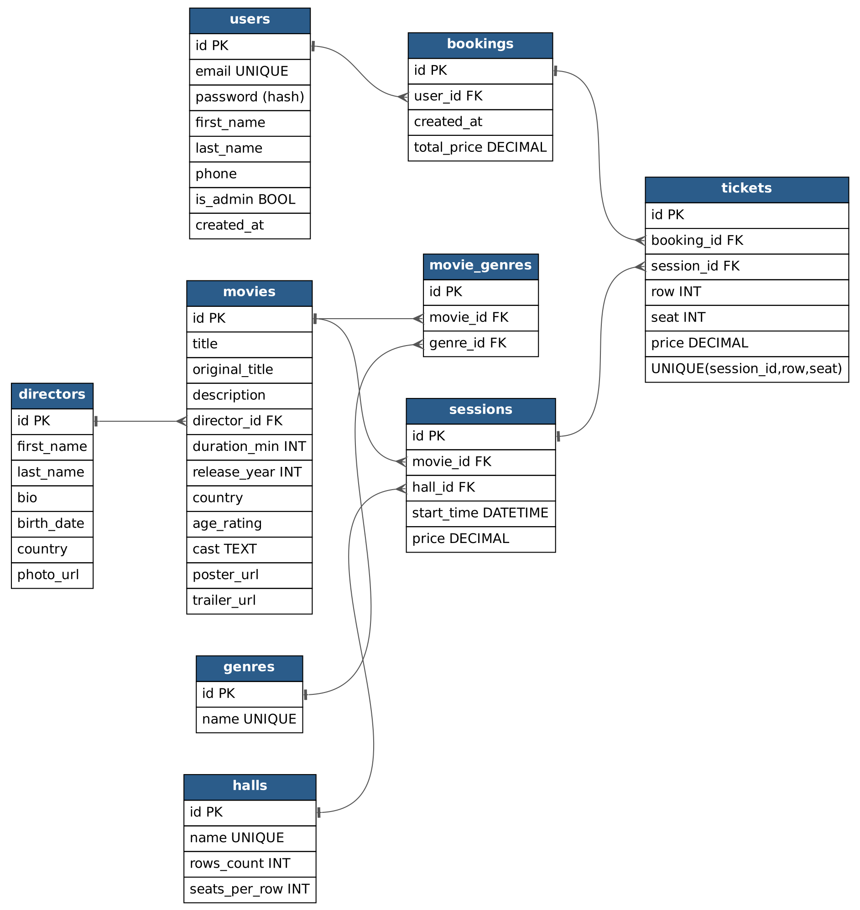

# 🎬 Кінотеатр «Кадр»

Вебсайт кінотеатру, де можна переглянути афішу, обрати сеанс і забронювати квитки онлайн.

## 📖 Опис

**«Кадр»** — сайт міського кінотеатру з кількома залами. Відвідувач може дізнатися, які фільми зараз у прокаті, коли вони показуються, і забронювати квитки на конкретні місця, не стоячи в черзі в касі.

### Що є на сайті

- **Афіша** — список усіх фільмів. Фільми можна шукати за назвою або режисером, фільтрувати за жанром, віковим обмеженням і датою показу. Список можна сортувати за назвою, роком виходу, тривалістю та популярністю (скільки квитків продано).
- **Сторінка фільму** — опис, постер, трейлер, режисер, жанри, тривалість, вікове обмеження, актори та розклад сеансів цього фільму.
- **Режисери** — список режисерів. На сторінці режисера є коротка біографія та всі його фільми, які є в кінотеатрі.
- **Жанри** — перелік жанрів. Якщо обрати жанр, показуються всі фільми цього жанру.
- **Розклад сеансів** — усі сеанси на обрану дату: фільм, зал, час початку і ціна квитка.
- **Вибір місць** — схема залу для обраного сеансу, на якій видно вільні та зайняті місця.
- **Бронювання** — зареєстрований користувач обирає одне або кілька вільних місць і натискає «Забронювати». Бронювання створюється відразу, без оплати (спрощення).
- **Реєстрація та вхід.**
- **Профіль** — особисті дані, які можна редагувати, та історія бронювань із квитками.
- **Адміністрування** — адміністратор може додавати, редагувати й видаляти фільми, режисерів, жанри, зали та сеанси.
- **«Про нас»** — адреса, контакти, як доїхати та правила повернення квитків. Це статична сторінка: вона зберігається на фронтенді й окремого ендпоінту не потребує.

## 🗂 Схема бази даних



Файл для редагування: [`docs/db_schema.drawio`](docs/db_schema.drawio).

Основні зв'язки:

- у фільму один режисер, а в режисера багато фільмів;
- фільм і жанр пов'язані як «багато до багатьох» через таблицю `movie_genres`;
- сеанс — це показ одного фільму в одному залі в певний час;
- бронювання належить одному користувачу й містить один або кілька квитків;
- квиток — це конкретне місце (ряд + номер) на конкретному сеансі. Обмеження `UNIQUE(session_id, row, seat)` не дає продати одне місце двічі.

## 🔌 REST API

### Загальні правила

- Базовий URL: `/api/v1`
- Дані передаються у форматі **JSON** (`Content-Type: application/json`).
- Назви ресурсів — іменники в множині (`/movies`, `/sessions`). Дію визначає HTTP-метод.
- Для оновлення використовується **`PATCH`**: передаються тільки ті поля, які треба змінити.
- Списки повертаються з пагінацією: параметри `page` (за замовчуванням 1) і `page_size` (за замовчуванням 20).

Формат відповіді зі списком:

```json
{
  "count": 125,
  "next": "/api/v1/movies?page=3",
  "previous": "/api/v1/movies?page=1",
  "results": [ ... ]
}
```

Формат відповіді з помилкою:

```json
{
  "error": "Опис помилки",
  "details": { "field_name": ["Повідомлення про помилку поля"] }
}
```

### Статус-коди

| Код | Значення |
|-----|----------|
| `200 OK` | Успішний запит |
| `201 Created` | Ресурс створено |
| `204 No Content` | Ресурс видалено, тіла відповіді немає |
| `400 Bad Request` | Некоректні дані в запиті |
| `401 Unauthorized` | Користувач не авторизований |
| `403 Forbidden` | Немає прав (наприклад, не адміністратор) |
| `404 Not Found` | Ресурс не знайдено |
| `409 Conflict` | Конфлікт, наприклад місце вже заброньоване |

### Права доступу

- 🌐 — доступно всім
- 👤 — тільки авторизованому користувачу
- 🔒 — тільки адміністратору

> **TBD:** механізм авторизації (сесії чи токени) та перевірку прав доступу буде визначено, коли ми вивчимо авторизацію. Поки що в описі вказано лише, кому має бути доступний кожен ендпоінт.

---

### 👤 Автентифікація

#### `POST /api/v1/auth/register` 🌐
Реєстрація нового користувача.

Request body:
```json
{
  "email": "olena@example.com",
  "password": "StrongPass123",
  "first_name": "Олена",
  "last_name": "Коваль",
  "phone": "+380501234567"
}
```
Response `201`:
```json
{
  "id": 7,
  "email": "olena@example.com",
  "first_name": "Олена",
  "last_name": "Коваль",
  "phone": "+380501234567"
}
```
Помилки: `400` — невалідні дані або такий email уже зареєстрований.

#### `POST /api/v1/auth/login` 🌐
Вхід у систему.

Request body:
```json
{ "email": "olena@example.com", "password": "StrongPass123" }
```
Response `200`:
```json
{ "id": 7, "email": "olena@example.com" }
```
Помилки: `400` — неправильний email або пароль.

> **TBD:** що саме повертати при вході (токен чи сесію) — обговорити.

#### `POST /api/v1/auth/logout` 👤
Вихід із системи. Response `204`, тіла немає.

---

### 🙋 Профіль користувача

#### `GET /api/v1/users/me` 👤
Повертає дані поточного користувача.

Response `200`:
```json
{
  "id": 7,
  "email": "olena@example.com",
  "first_name": "Олена",
  "last_name": "Коваль",
  "phone": "+380501234567"
}
```

#### `PATCH /api/v1/users/me` 👤
Редагування даних про себе.

Request body (будь-які з полів):
```json
{ "phone": "+380671112233" }
```
Response `200`: оновлений профіль (у тому ж форматі, що й `GET /users/me`). Помилки: `400`.

#### `GET /api/v1/users/me/bookings` 👤
Історія бронювань поточного користувача, від найновіших.

Response `200`:
```json
{
  "count": 2,
  "next": null,
  "previous": null,
  "results": [
    {
      "id": 31,
      "created_at": "2026-10-10T18:22:00Z",
      "total_price": 360.00,
      "session": {
        "id": 105,
        "start_time": "2026-10-12T19:30:00Z",
        "hall": "Зал 2",
        "movie": { "id": 12, "title": "Дюна: Частина друга" }
      },
      "tickets": [
        { "id": 88, "row": 5, "seat": 7, "price": 180.00 },
        { "id": 89, "row": 5, "seat": 8, "price": 180.00 }
      ]
    }
  ]
}
```

---

### 🎞 Фільми

#### `GET /api/v1/movies` 🌐
Список фільмів (афіша).

Query-параметри (усі необов'язкові):

| Параметр | Опис | Приклад |
|----------|------|---------|
| `search` | пошук за назвою фільму або ім'ям режисера | `search=нолан` |
| `genre` | id жанру | `genre=3` |
| `director` | id режисера | `director=5` |
| `age_rating` | вікове обмеження | `age_rating=16+` |
| `date` | тільки фільми, які показуються в цю дату | `date=2026-10-20` |
| `ordering` | сортування: `title`, `release_year`, `duration_min`, `popularity`. Мінус перед назвою означає спадання | `ordering=-popularity` |
| `page`, `page_size` | пагінація | `page=2&page_size=10` |

Приклад: `GET /api/v1/movies?genre=3&ordering=-release_year&page=1`

Response `200`:
```json
{
  "count": 42,
  "next": "/api/v1/movies?genre=3&ordering=-release_year&page=2",
  "previous": null,
  "results": [
    {
      "id": 12,
      "title": "Дюна: Частина друга",
      "poster_url": "https://example.com/posters/dune2.jpg",
      "release_year": 2024,
      "duration_min": 166,
      "age_rating": "12+",
      "genres": [{ "id": 3, "name": "Фантастика" }],
      "director": { "id": 5, "first_name": "Дені", "last_name": "Вільнев" }
    }
  ]
}
```

#### `GET /api/v1/movies/{id}` 🌐
Детальна інформація про фільм.

Response `200`:
```json
{
  "id": 12,
  "title": "Дюна: Частина друга",
  "original_title": "Dune: Part Two",
  "description": "Пол Атрід об'єднується з фрименами...",
  "director": { "id": 5, "first_name": "Дені", "last_name": "Вільнев" },
  "genres": [{ "id": 3, "name": "Фантастика" }, { "id": 7, "name": "Пригоди" }],
  "duration_min": 166,
  "release_year": 2024,
  "country": "США",
  "age_rating": "12+",
  "cast": "Тімоті Шаламе, Зендея, Ребекка Фергюсон",
  "poster_url": "https://example.com/posters/dune2.jpg",
  "trailer_url": "https://youtube.com/watch?v=..."
}
```
Помилки: `404`.

#### `GET /api/v1/movies/{id}/sessions` 🌐
Майбутні сеанси цього фільму. Необов'язковий параметр: `date`.

Response `200`:
```json
[
  { "id": 105, "start_time": "2026-10-12T19:30:00Z", "hall": { "id": 2, "name": "Зал 2" }, "price": 180.00, "free_seats": 54 }
]
```
Помилки: `404` — фільм не знайдено.

#### `POST /api/v1/movies` 🔒
Додати фільм.

Request body:
```json
{
  "title": "Дюна: Частина друга",
  "original_title": "Dune: Part Two",
  "description": "Пол Атрід об'єднується з фрименами...",
  "director_id": 5,
  "genre_ids": [3, 7],
  "duration_min": 166,
  "release_year": 2024,
  "country": "США",
  "age_rating": "12+",
  "cast": "Тімоті Шаламе, Зендея, Ребекка Фергюсон",
  "poster_url": "https://example.com/posters/dune2.jpg",
  "trailer_url": "https://youtube.com/watch?v=..."
}
```
Response `201`: створений фільм (у форматі `GET /movies/{id}`). Помилки: `400`, `401`, `403`.

#### `PATCH /api/v1/movies/{id}` 🔒
Редагувати фільм. У request body передаються лише поля, які змінюються:
```json
{ "age_rating": "16+", "genre_ids": [3] }
```
Response `200`: оновлений фільм. Помилки: `400`, `401`, `403`, `404`.

#### `DELETE /api/v1/movies/{id}` 🔒
Видалити фільм. Response `204`. Помилки: `401`, `403`, `404`.

> **TBD:** що робити, якщо на фільм уже є заброньовані квитки (заборонити видалення з кодом `409` чи приховувати фільм) — обговорити.

---

### 🎥 Режисери

#### `GET /api/v1/directors` 🌐
Список режисерів. Параметри: `search` (за іменем або прізвищем), `ordering` (`last_name`, `-last_name`), `page`, `page_size`.

Response `200`:
```json
{
  "count": 18,
  "next": null,
  "previous": null,
  "results": [
    { "id": 5, "first_name": "Дені", "last_name": "Вільнев", "photo_url": "https://example.com/d/5.jpg" }
  ]
}
```

#### `GET /api/v1/directors/{id}` 🌐
Інформація про режисера.

Response `200`:
```json
{
  "id": 5,
  "first_name": "Дені",
  "last_name": "Вільнев",
  "bio": "Канадський кінорежисер і сценарист...",
  "birth_date": "1967-10-03",
  "country": "Канада",
  "photo_url": "https://example.com/d/5.jpg"
}
```
Помилки: `404`.

#### `GET /api/v1/directors/{id}/movies` 🌐
Усі фільми режисера, які є в кінотеатрі. Формат відповіді і параметри (`ordering`, `page`) такі самі, як у `GET /movies`. Помилки: `404`.

#### `POST /api/v1/directors` 🔒
Request body:
```json
{
  "first_name": "Дені",
  "last_name": "Вільнев",
  "bio": "Канадський кінорежисер...",
  "birth_date": "1967-10-03",
  "country": "Канада",
  "photo_url": "https://example.com/d/5.jpg"
}
```
Response `201`: створений режисер. Помилки: `400`, `401`, `403`.

#### `PATCH /api/v1/directors/{id}` 🔒
Request body: поля, які змінюються. Response `200`. Помилки: `400`, `401`, `403`, `404`.

#### `DELETE /api/v1/directors/{id}` 🔒
Response `204`. Помилки: `401`, `403`, `404`, `409` (у режисера є фільми в базі).

---

### 🏷 Жанри

#### `GET /api/v1/genres` 🌐
Список усіх жанрів (без пагінації, бо їх небагато).

Response `200`:
```json
[
  { "id": 3, "name": "Фантастика" },
  { "id": 7, "name": "Пригоди" }
]
```

Фільми певного жанру отримуємо через `GET /api/v1/movies?genre={id}`.

#### `POST /api/v1/genres` 🔒
Request body: `{ "name": "Комедія" }`. Response `201`: `{ "id": 9, "name": "Комедія" }`. Помилки: `400` (такий жанр уже існує), `401`, `403`.

#### `PATCH /api/v1/genres/{id}` 🔒
Request body: `{ "name": "Кінокомедія" }`. Response `200`. Помилки: `400`, `401`, `403`, `404`.

#### `DELETE /api/v1/genres/{id}` 🔒
Response `204`. Помилки: `401`, `403`, `404`.

---

### 🏛 Зали

#### `GET /api/v1/halls` 🌐
Response `200`:
```json
[
  { "id": 1, "name": "Зал 1", "rows_count": 10, "seats_per_row": 14 },
  { "id": 2, "name": "Зал 2", "rows_count": 6, "seats_per_row": 10 }
]
```

#### `GET /api/v1/halls/{id}` 🌐
Response `200`: один зал (формат як вище). Помилки: `404`.

#### `POST /api/v1/halls` 🔒
Request body:
```json
{ "name": "Зал 3", "rows_count": 8, "seats_per_row": 12 }
```
Response `201`: створений зал. Помилки: `400`, `401`, `403`.

#### `PATCH /api/v1/halls/{id}` 🔒
Response `200`. Помилки: `400`, `401`, `403`, `404`.

#### `DELETE /api/v1/halls/{id}` 🔒
Response `204`. Помилки: `401`, `403`, `404`, `409` (у залі є заплановані сеанси).

---

### 🕒 Сеанси

#### `GET /api/v1/sessions` 🌐
Розклад сеансів.

| Параметр | Опис | Приклад |
|----------|------|---------|
| `date` | дата показу (за замовчуванням сьогодні) | `date=2026-10-20` |
| `movie` | id фільму | `movie=12` |
| `hall` | id залу | `hall=2` |
| `ordering` | `start_time`, `price` (з мінусом — спадання) | `ordering=start_time` |
| `page`, `page_size` | пагінація | |

Response `200`:
```json
{
  "count": 9,
  "next": null,
  "previous": null,
  "results": [
    {
      "id": 105,
      "movie": { "id": 12, "title": "Дюна: Частина друга", "poster_url": "https://example.com/posters/dune2.jpg", "age_rating": "12+" },
      "hall": { "id": 2, "name": "Зал 2" },
      "start_time": "2026-10-20T19:30:00Z",
      "price": 180.00,
      "free_seats": 54
    }
  ]
}
```

#### `GET /api/v1/sessions/{id}` 🌐
Один сеанс (формат як елемент списку вище). Помилки: `404`.

#### `GET /api/v1/sessions/{id}/seats` 🌐
Схема залу для сеансу: розмір залу і зайняті місця. Фронтенд малює за нею схему вибору місць.

Response `200`:
```json
{
  "session_id": 105,
  "rows_count": 6,
  "seats_per_row": 10,
  "taken_seats": [
    { "row": 5, "seat": 7 },
    { "row": 5, "seat": 8 }
  ]
}
```
Помилки: `404`.

#### `POST /api/v1/sessions` 🔒
Request body:
```json
{ "movie_id": 12, "hall_id": 2, "start_time": "2026-10-20T19:30:00Z", "price": 180.00 }
```
Response `201`: створений сеанс. Помилки: `400` (наприклад, сеанс у минулому), `401`, `403`, `409` (зал у цей час уже зайнятий іншим сеансом).

#### `PATCH /api/v1/sessions/{id}` 🔒
Response `200`. Помилки: `400`, `401`, `403`, `404`, `409`.

#### `DELETE /api/v1/sessions/{id}` 🔒
Response `204`. Помилки: `401`, `403`, `404`.

> **TBD:** що відбувається з бронюваннями, якщо сеанс видалили чи перенесли, — обговорити.

---

### 🎟 Бронювання

#### `POST /api/v1/bookings` 👤
Забронювати одне або кілька місць на сеанс. Оплати немає: бронювання створюється відразу.

Request body:
```json
{
  "session_id": 105,
  "seats": [
    { "row": 5, "seat": 7 },
    { "row": 5, "seat": 8 }
  ]
}
```
Response `201`:
```json
{
  "id": 31,
  "created_at": "2026-10-10T18:22:00Z",
  "total_price": 360.00,
  "session": {
    "id": 105,
    "start_time": "2026-10-20T19:30:00Z",
    "hall": "Зал 2",
    "movie": { "id": 12, "title": "Дюна: Частина друга" }
  },
  "tickets": [
    { "id": 88, "row": 5, "seat": 7, "price": 180.00 },
    { "id": 89, "row": 5, "seat": 8, "price": 180.00 }
  ]
}
```
Помилки:
- `400` — порожній список місць, місця немає в залі або сеанс уже почався;
- `401` — не авторизований;
- `404` — сеанс не знайдено;
- `409` — одне з місць уже заброньоване.

#### `GET /api/v1/bookings/{id}` 👤
Перегляд одного свого бронювання (формат як у відповіді вище). Помилки: `401`, `403` (бронювання іншого користувача), `404`.

> **TODO:** можливо, додати скасування бронювання — обговорити правила повернення.

---

### 📋 Коротка таблиця ендпоінтів

| Метод | Ендпоінт | Опис | Доступ |
|-------|----------|------|--------|
| POST | `/auth/register` | Реєстрація | 🌐 |
| POST | `/auth/login` | Вхід | 🌐 |
| POST | `/auth/logout` | Вихід | 👤 |
| GET | `/users/me` | Мій профіль | 👤 |
| PATCH | `/users/me` | Редагувати профіль | 👤 |
| GET | `/users/me/bookings` | Історія бронювань | 👤 |
| GET | `/movies` | Афіша з пошуком, фільтрами, сортуванням | 🌐 |
| GET | `/movies/{id}` | Сторінка фільму | 🌐 |
| GET | `/movies/{id}/sessions` | Сеанси фільму | 🌐 |
| POST | `/movies` | Додати фільм | 🔒 |
| PATCH | `/movies/{id}` | Редагувати фільм | 🔒 |
| DELETE | `/movies/{id}` | Видалити фільм | 🔒 |
| GET | `/directors` | Список режисерів | 🌐 |
| GET | `/directors/{id}` | Сторінка режисера | 🌐 |
| GET | `/directors/{id}/movies` | Фільми режисера | 🌐 |
| POST | `/directors` | Додати режисера | 🔒 |
| PATCH | `/directors/{id}` | Редагувати режисера | 🔒 |
| DELETE | `/directors/{id}` | Видалити режисера | 🔒 |
| GET | `/genres` | Список жанрів | 🌐 |
| POST | `/genres` | Додати жанр | 🔒 |
| PATCH | `/genres/{id}` | Редагувати жанр | 🔒 |
| DELETE | `/genres/{id}` | Видалити жанр | 🔒 |
| GET | `/halls` | Список залів | 🌐 |
| GET | `/halls/{id}` | Один зал | 🌐 |
| POST | `/halls` | Додати зал | 🔒 |
| PATCH | `/halls/{id}` | Редагувати зал | 🔒 |
| DELETE | `/halls/{id}` | Видалити зал | 🔒 |
| GET | `/sessions` | Розклад сеансів | 🌐 |
| GET | `/sessions/{id}` | Один сеанс | 🌐 |
| GET | `/sessions/{id}/seats` | Зайняті місця на сеансі | 🌐 |
| POST | `/sessions` | Додати сеанс | 🔒 |
| PATCH | `/sessions/{id}` | Редагувати сеанс | 🔒 |
| DELETE | `/sessions/{id}` | Видалити сеанс | 🔒 |
| POST | `/bookings` | Забронювати місця | 👤 |
| GET | `/bookings/{id}` | Моє бронювання | 👤 |
